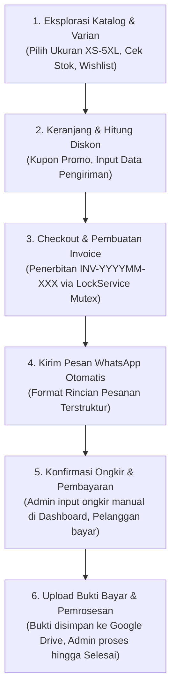

# Product Requirements Document (PRD): AryaStore E-Commerce Engine

> **Spesifikasi Resmi Platform Fashion & Apparel E-Commerce Terpadu (Storefront & RBAC Admin Dashboard)**  
> Versi Dokumen: v1.0.0 (Disetujui untuk Implementasi)  
> Arsitektur Target: Serverless Google Apps Script + Google Sheets Database

---

## ZONA ATAS: SPESIFIKASI KEBUTUHAN PRODUK (BLUEPRINT AWAL)

### 1. Identitas & Ruang Lingkup Produk

#### 1.1 Profil Sistem & Brand
- **Nama Brand / Platform**: **AryaStore** (Koleksi Busana & Apparel Minimalis Kontemporer).
- **Tujuan Utama**: Menyediakan etalase digital (*storefront*) berestetika editorial premium dengan konversi tinggi, terintegrasi langsung dengan pemesanan WhatsApp, verifikasi pembayaran manual melalui Google Drive, dan panel operasional (*admin dashboard*) berbasis peran (RBAC dengan autentikasi PIN).
- **Bahasa Resmi Platform**: 100% Bahasa Indonesia untuk seluruh antarmuka pelanggan, label form, pesan sistem, status pesanan, dan menu administrasi.

#### 1.2 Target Pengguna & Matriks Hak Akses (RBAC Berbasis PIN)
Sistem membagi pengguna menjadi dua kelompok utama:
1. **Pelanggan Publik (Customer)**:
   - Menjelajahi katalog busana editorial dengan filter multi-atribut (kategori, harga, ukuran XS hingga 5XL, badge).
   - Memilih varian warna dan ukuran dengan pengecekan stok langsung (*real-time*).
   - Menyimpan produk favorit ke Wishlist lokal (*client-side localStorage*).
   - Memasukkan produk atau paket bundling ke keranjang belanja, menerapkan kupon diskon, dan melakukan checkout via WhatsApp.
   - Melacak status pesanan (*order tracking*), mengunggah bukti transfer, dan mengajukan retur (*size exchange* / refund).
2. **Tim Operasional Internal (RBAC Berbasis PIN)**:
   Autentikasi menggunakan PIN numerik aman yang divalidasi ke lembar konfigurasi sistem (*Settings*):
   - **Super Admin (PIN Default: `9999`)**: Akses penuh tanpa batas ke seluruh modul (Ringkasan KPI, Manajemen Produk & Varian, Manajemen Pesanan & Ongkir, Analisis Konversi, Kupon, Pelanggan, Kampanye & Flash Sale, Retur, Audit Log, dan Pengaturan Sistem).
   - **Store Manager (PIN Default: `8888`)**: Fokus pada operasional katalog dan pemenuhan pesanan (Katalog Produk, Stok Varian SKU, Manajemen Pesanan & Ongkir, Kampanye Flash Sale & Bundling).
   - **Customer Service (PIN Default: `7777`)**: Fokus pada layanan pelanggan dan penyelesaian transaksi (Manajemen Pesanan, Verifikasi Bukti Pembayaran, Antrean Retur & Refund, Direktori Pelanggan).

#### 1.3 Keputusan Kunci Arsitektur & Ruang Lingkup (Scope Alignment)
Sesuai kesepakatan spesifikasi final, parameter berikut telah ditetapkan secara definitif:
- **Loyalty Points Ditiadakan**: Tidak ada sistem poin loyalitas atau tingkatan membership. Alur diskon berpusat penuh pada kode kupon promo transparan.
- **Ulasan & Rating Ditiadakan**: Tidak ada bintang rating atau daftar ulasan pelanggan pada kartu dan modal produk, mempertahankan estetika katalog editorial minimalis yang bersih.
- **Wishlist Berbasis LocalStorage**: Penyimpanan item favorit berjalan murni di sisi browser pengguna tanpa membebani database Google Sheets.
- **Hosting Bukti Pembayaran di Google Drive**: File bukti transfer diunggah sebagai base64 melalui antarmuka web, diproses oleh backend Apps Script menggunakan `DriveApp`, disimpan dalam folder Google Drive, dan menghasilkan URL gambar publik untuk ditinjau oleh tim admin.

---

### 2. Arsitektur Data & Struktur Lembar Kerja (Google Sheets)

Seluruh data disimpan dalam satu Google Spreadsheet dengan 10 tab lembar kerja. Penamaan tab strictly tanpa karakter garis bawah (*underscore*):

```
Google Spreadsheet (AryaStore Database)
 ├── Products
 ├── ProductVariants
 ├── CampaignsAndBundles
 ├── Orders
 ├── Customers
 ├── Coupons
 ├── Returns
 ├── AuditLogs
 ├── EventLogs
 └── Settings
```

#### 2.1 Spesifikasi Kolom Tiap Lembar Kerja

1. **`Products`** (Katalog Busana Utama)
   - Indeks 0: `id` (String, format `PRD-001`)
   - Indeks 1: `name` (String, nama artikel fashion)
   - Indeks 2: `category` (Enum: `Outerwear`, `Tops`, `Bottoms`, `Footwear`, `Accessories`)
   - Indeks 3: `base_price` (Number, harga dasar dalam IDR)
   - Indeks 4: `badge` (Enum: `New Arrival`, `Best Seller`, `Limited Edition`, `None`)
   - Indeks 5: `description` (String, deskripsi material dan potongan pakaian)
   - Indeks 6: `image_url` (String, URL gambar utama artikel)
   - Indeks 7: `created_at` (String, format `YYYY-MM-DD HH:mm:ss`)

2. **`ProductVariants`** (Matriks SKU, Warna, Ukuran & Stok)
   - Indeks 0: `variant_id` (String, format `VAR-001`)
   - Indeks 1: `product_id` (String, merujuk ke `Products.id`)
   - Indeks 2: `sku` (String, kode unik stok, contoh `OAT-BLK-M`)
   - Indeks 3: `color` (String, label warna, contoh: `Hitam Arang`, `Putih Tulang`, `Terracotta`)
   - Indeks 4: `size` (Enum: `XS`, `S`, `M`, `L`, `XL`, `XXL`, `3XL`, `4XL`, `5XL`)
   - Indeks 5: `stock` (Number, jumlah unit tersedia)

3. **`CampaignsAndBundles`** (Flash Sale & Paket Busana)
   - Indeks 0: `campaign_id` (String, format `CMP-001`)
   - Indeks 1: `banner_title` (String, judul kampanye editorial)
   - Indeks 2: `banner_desc` (String, deskripsi promo)
   - Indeks 3: `ends_at` (String ISO / Datetime untuk countdown timer)
   - Indeks 4: `is_active` (Boolean: `TRUE` / `FALSE`)
   - Indeks 5: `bundle_items_json` (String JSON array berisi daftar item kombinasi)
   - Indeks 6: `normal_price` (Number, akumulasi harga satuan)
   - Indeks 7: `bundle_price` (Number, harga spesial bundling)

4. **`Orders`** (Transaksi & Pengiriman)
   - Indeks 0: `invoice_no` (String, format unik `INV-YYYYMM-XXX`)
   - Indeks 1: `created_at` (String, format `YYYY-MM-DD HH:mm:ss`)
   - Indeks 2: `customer_id` (String, format `CST-001`)
   - Indeks 3: `customer_name` (String, nama penerima)
   - Indeks 4: `whatsapp_no` (String, nomor kontak WhatsApp)
   - Indeks 5: `items_json` (String JSON array berisi item, SKU, warna, ukuran, qty, harga)
   - Indeks 6: `subtotal` (Number, total harga produk sebelum potongan)
   - Indeks 7: `coupon_code` (String, kode promo yang digunakan atau string kosong)
   - Indeks 8: `coupon_discount` (Number, nominal potongan kupon dalam IDR)
   - Indeks 9: `shipping_method` (Enum: `Reguler (JNE/J&T)`, `Express (SiCepat/Paxel)`, `Ambil di Toko`)
   - Indeks 10: `shipping_cost` (Number, nominal ongkir manual yang diisi admin, default `0`)
   - Indeks 11: `grand_total` (Number, `subtotal - coupon_discount + shipping_cost`)
   - Indeks 12: `payment_proof_url` (String URL Google Drive atau kosong jika belum upload)
   - Indeks 13: `status` (Enum: `Menunggu Pembayaran`, `Bukti Diupload`, `Diproses`, `Dikirim`, `Selesai`, `Dibatalkan`)

5. **`Customers`** (Buku Alamat & Riwayat Pelanggan)
   - Indeks 0: `customer_id` (String, format `CST-001`)
   - Indeks 1: `name` (String, nama lengkap)
   - Indeks 2: `whatsapp_no` (String, nomor WhatsApp aktif)
   - Indeks 3: `total_orders` (Number, frekuensi transaksi selesai)
   - Indeks 4: `total_spent` (Number, total pengeluaran kumulatif dalam IDR)
   - Indeks 5: `created_at` (String, format `YYYY-MM-DD HH:mm:ss`)
   - Indeks 6: `notes` (String, catatan preferensi pelanggan)

6. **`Coupons`** (Manajemen Promo Diskon)
   - Indeks 0: `code` (String uppercase, contoh: `WELCOME10`, `HEMAT50K`)
   - Indeks 1: `discount_type` (Enum: `PERCENT`, `FIXED`)
   - Indeks 2: `discount_value` (Number, persentase diskon atau nominal IDR)
   - Indeks 3: `min_spend` (Number, batas belanja minimal)
   - Indeks 4: `description` (String, syarat & ketentuan singkat)
   - Indeks 5: `is_active` (Boolean: `TRUE` / `FALSE`)

7. **`Returns`** (Pengajuan Tukar Ukuran & Pengembalian)
   - Indeks 0: `return_id` (String, format unik `RTR-YYYYMM-XXX`)
   - Indeks 1: `invoice_no` (String, merujuk ke `Orders.invoice_no`)
   - Indeks 2: `customer_name` (String, nama pemohon)
   - Indeks 3: `reason` (String, alasan penukaran seperti ukuran terlalu sempit/longgar)
   - Indeks 4: `requested_size` (String, ukuran pengganti yang diinginkan)
   - Indeks 5: `status` (Enum: `Diajukan`, `Disetujui`, `Ditolak`, `Selesai`)
   - Indeks 6: `admin_notes` (String, instruksi pengiriman retur atau alasan penolakan)

8. **`AuditLogs`** (Jejak Aktivitas & Keamanan)
   - Indeks 0: `timestamp` (String, format `YYYY-MM-DD HH:mm:ss`)
   - Indeks 1: `actor_role` (Enum: `Super Admin`, `Store Manager`, `Customer Service`, `System`)
   - Indeks 2: `module` (String, modul yang dimodifikasi, contoh: `Orders`, `Products`, `Settings`)
   - Indeks 3: `action_detail` (String, rincian aktivitas dan data sebelum/sesudah)

9. **`EventLogs`** (Pelacakan Funnel Konversi)
   - Indeks 0: `timestamp` (String, format `YYYY-MM-DD HH:mm:ss`)
   - Indeks 1: `event_name` (Enum: `product_view`, `add_to_cart`, `wa_checkout`, `order_completed`)
   - Indeks 2: `payload_json` (String JSON berisi konteks item/invoice)

10. **`Settings`** (Konfigurasi Global & Kunci Keamanan)
    - Indeks 0: `key` (String, kunci konfigurasi)
    - Indeks 1: `value` (String, nilai konfigurasi)
    - Indeks 2: `description` (String, penjelasan fungsi parameter)

---

### 3. Alur Pengguna & Transaksi 6 Langkah (End-to-End Workflow)



#### Rincian Langkah Transaksi:
1. **Langkah 1 (Pilih Busana)**: Pelanggan membuka katalog, melihat badge editorial, memilih warna dan ukuran pada modal detail, memeriksa panduan ukuran (*Size Guide Modal*), lalu menambahkan ke keranjang belanja atau menyimpannya ke Wishlist lokal.
2. **Langkah 2 (Keranjang Belanja)**: Pelanggan membuka slide-over Cart Drawer, memasukkan kode kupon promo (`WELCOME10`), memilih estimasi pengiriman, serta mengisi identitas penerima dan alamat pengiriman.
3. **Langkah 3 (Penerbitan Invoice)**: Sistem mengeksekusi backend mutex dengan `LockService.getScriptLock()` untuk membuat nomor pesanan sekuensial anti-tabrakan berformat `INV-YYYYMM-XXX`, merekam data ke sheet `Orders` dengan status `Menunggu Pembayaran`.
4. **Langkah 4 (Arahkan ke WhatsApp Toko)**: Antarmuka secara otomatis menyusun draf pesan WhatsApp lengkap dengan nomor invoice, daftar belanja, alamat, dan total biaya, lalu membuka tautan `https://wa.me/{nomor_toko}`.
5. **Langkah 5 (Penyesuaian Ongkir Manual)**: Admin memeriksa pesanan di Admin Dashboard, menginput biaya ongkos kirim riil, sehingga Grand Total terbarui secara transparan.
6. **Langkah 6 (Unggah Bukti & Selesai)**: Pelanggan menggunakan fitur Lacak Pesanan (*Order Tracker*), mengunggah foto struk transfer manual. Backend mengonversi data base64 ke file di Google Drive dan mencatat tautannya ke lembar kerja. Admin memvalidasi bukti, mengubah status bertahap (`Diproses` -> `Dikirim` -> `Selesai`).

---

### 4. Spesifikasi Antarmuka Pengguna (UI/UX)

#### 4.1 Etalase Toko (Storefront)
- **Header Editorial Minimalis**: Logo tipografi teks murni, navigasi kategori, tombol pencarian cepat, ikon Wishlist dengan badge jumlah lokal, dan ikon Keranjang Belanja.
- **Hero Banner Koleksi Musiman**: Tipografi serif kontemporer bernada editorial majalah fashion, tombol aksi utama `Lihat Koleksi` dan tombol `Panduan Ukuran`.
- **Flash Sale & Paket Bundling**: Penghitung waktu mundur (*countdown timer*) aktif, kartu paket busana (*Outfit Bundle Card*) dengan kalkulasi penghematan dan tombol instan `+ Ambil Bundle`.
- **Bar Filter & Pencarian Lengkap**:
  - Tab kategori (`Semua`, `Outerwear`, `Tops`, `Bottoms`, `Footwear`, `Accessories`).
  - Slider rentang batas harga maksimal (IDR 0 hingga IDR 2.000.000+).
  - Chip pemilih ketersediaan ukuran (`XS`, `S`, `M`, `L`, `XL`, `XXL`, `3XL`, `4XL`, `5XL`).
  - Filter badge koleksi (`New Arrival`, `Best Seller`, `Limited Edition`).
  - Dropdown pengurutan (Terbaru, Harga Terendah, Harga Tertinggi) dan tombol `Reset Filter`.
- **Grid Produk Responsif**: Tata letak 2 kolom pada layar ponsel pintar (*mobile*) dan 4 kolom pada layar desktop.
- **Modal Detail Produk & Varian**: Pilihan palet warna visual (*color swatches*), selektor ukuran dengan label stok dinamis, tombol `Tambah ke Keranjang`, dan tombol simpan ke Wishlist.
- **Modal Panduan Ukuran (Size Guide)**: Tabel komprehensif lingkar dada, panjang badan, lingkar pinggang, dan lingkar pinggul untuk ukuran XS sampai 5XL.
- **Drawer Keranjang Belanja (Slide-Over Cart)**: Rincian item dengan pengatur kuantitas, input kupon promo, pilihan opsi pengiriman, kalkulasi subtotal dan diskon, serta tombol utama `Checkout via WhatsApp`.
- **Modal Lacak Pesanan & Upload Bukti**: Pencarian instan menggunakan Nomor Invoice (`INV-YYYYMM-XXX`) dan nomor WhatsApp. Menampilkan status terkini, rincian biaya, preview bukti bayar, dan formulir unggah struk pembayaran langsung ke Google Drive.
- **Modal Pengajuan Retur**: Formulir permohonan penukaran ukuran bagi pesanan berstatus `Dikirim` atau `Selesai` dengan input alasan dan pilihan ukuran pengganti.

#### 4.2 Panel Administrasi Toko (Admin Dashboard)
- **Gerbang Akses PIN Terproteksi**: Modal autentikasi dengan input PIN numerik 4 digit untuk membuka dasbor sesuai peran (Super Admin, Store Manager, Customer Service).
- **Grid KPI 4 Metrik Utama**: Total Pendapatan Kotor, Total Pesanan Masuk, Total Unit Terjual, dan Jumlah Pelanggan Terdaftar.
- **Manajer Produk & Matriks Varian**: Daftar produk terstruktur, modal tambah/edit produk, dan pengeditan stok varian per SKU dengan indikator peringatan stok menipis (*low-stock badge* jika stok < 5).
- **Manajer Pesanan & Konfirmasi Ongkir**: Tab status pesanan terorganisir (`Semua`, `Menunggu Pembayaran`, `Bukti Diupload`, `Diproses`, `Dikirim`, `Selesai`, `Dibatalkan`), input inline untuk biaya ongkos kirim manual, modal pratinjau gambar bukti transfer, dan tombol pembaruan status bertahap.
- **Corong Konversi (Conversion Funnel)**: Visualisasi murni CSS untuk 4 tahap konversi (*Product Views* -> *Add to Cart* -> *WA Checkout* -> *Order Completed*) beserta tombol ekspor riwayat pesanan ke format CSV.
- **Manajer Kupon Diskon**: Tambah dan nonaktifkan kode kupon promo beserta aturan minimal belanja.
- **Direktori Pelanggan**: Daftar pelanggan, nomor kontak WhatsApp untuk re-engagement, total belanja akumulatif, dan frekuensi transaksi.
- **Manajer Flash Sale & Bundling**: Pengaturan durasi countdown timer dan penetapan harga paket bundling hemat.
- **Antrean Retur & Resolusi**: Tinjau pengajuan tukar ukuran dengan opsi persetujuan atau penolakan disertai catatan admin.
- **Log Audit Keamanan**: Rekaman kronologis waktu, peran aktor, modul, dan detail aktivitas untuk akuntabilitas operasional.

---

### 5. Aturan Rekayasa & Standar Integritas Data

1. **Penomoran Dokumen Anti-Tabrakan**:
   - `INV-YYYYMM-XXX` dan `RTR-YYYYMM-XXX` dibuat menggunakan `LockService.getScriptLock()` dengan batas waktu tunggu 10 detik.
   - Angka sekuensial dihitung dari `MAX + 1` pada data bulan berjalan.
2. **Pengambilan Data Berbasis Indeks Kolom**:
   - Dilarang keras membaca baris menggunakan nama string header `row['name']`.
   - Wajib menggunakan konstanta indeks kolom numerik berbasis nol (`const COL_PRODUCTS = { ID: 0, NAME: 1, ... }`).
3. **Optimasi Pembacaan & Penulisan Google Sheets**:
   - Pembacaan data wajib menggunakan `sheet.getDataRange().getDisplayValues()` untuk format teks stabil.
   - Setiap operasi manipulasi data wajib diakhiri dengan `SpreadsheetApp.flush()`.
4. **Resiliensi Antarmuka Pengguna (Anti-Freeze UI)**:
   - Setiap tombol submit wajib memanggil `event.preventDefault()`, menampilkan spinner pemuatan, dan dinonaktifkan sementara.
   - Penanganan error wajib menyertakan `.withFailureHandler()` untuk mengembalikan tombol ke keadaan aktif bila terjadi kendala jaringan.
5. **Mode Pratinjau Aman (Safe Preview Mode)**:
   - Kode antarmuka mendeteksi apakah `google.script.run` tersedia secara lokal. Jika dibuka langsung di browser luar lingkungan Google Apps Script, sistem menyajikan data simulasi agar tampilan tetap dapat dievaluasi tanpa error konsol.

---

## ZONA BAWAH: MASTER CONTEXT & LOGIKA SISTEM TERKINI (LIVING CONTEXT)

### 1. Status Arsitektur Aktif
- **Runtime Target**: Google Apps Script Web App (Serverless V8 Engine).
- **Database Engine**: Google Sheets Database (10 Tab Mandiri tanpa underscore).
- **Frontend Architecture**: Single Page Application terpadu di dalam `index.html` (HTML5, Tailwind CSS via CDN, Vanilla JavaScript modular, Lucide Icons SVG).
- **File Repositori Resmi**:
  1. `prd.md`: Spesifikasi produk dan living context (dokumen ini).
  2. `design.md`: Pedoman desain editorial minimalis, palet warna, tipografi, dan kepatuhan antislop.
  3. `AGENTS.md`: Panduan rekayasa sistem, aturan coding, dan instruksi agen pengembang.
  4. `setup.gs`: Skrip migrasi skema database dan injeksi data awal (*seed data*).
  5. `code.gs`: Logika server-side backend API Google Apps Script.
  6. `index.html`: Antarmuka storefront publik dan admin dashboard RBAC.

### 2. Matriks Konfigurasi Default Sistem (`Settings`)

| Kunci Konfigurasi | Nilai Default | Penjelasan |
|---|---|---|
| `BRAND_NAME` | `AryaStore` | Nama toko fashion yang tampil di header dan pesan invoice |
| `WA_NUMBER` | `6281234567890` | Nomor WhatsApp tujuan penerimaan pesanan checkout |
| `CURRENCY_PREFIX` | `Rp ` | Format prefiks mata uang |
| `PIN_SUPER_ADMIN` | `9999` | Kunci otorisasi akses penuh ke seluruh modul sistem |
| `PIN_STORE_MANAGER` | `8888` | Kunci otorisasi manajemen produk, stok, dan pesanan |
| `PIN_CUSTOMER_SERVICE` | `7777` | Kunci otorisasi penanganan pesanan dan retur |
| `SHIPPING_METHODS` | `Reguler (JNE/J&T),Express (SiCepat/Paxel),Ambil di Toko` | Daftar metode pengiriman yang tersedia pada keranjang |
| `DRIVE_FOLDER_NAME` | `ARYA_ECOMMERCE_PAYMENTS` | Nama folder Google Drive penampung bukti pembayaran |

### 3. Log Pembaruan Resmi (Version History)
- **v1.0.0 (2026-11-21)**: Inisialisasi awal cetak biru sistem. Penegasan ruang lingkup: eliminasi sistem loyalty points dan ulasan produk, implementasi wishlist client-side di localStorage, penyimpanan bukti bayar di Google Drive, serta penerapan sistem RBAC berbasis autentikasi PIN 3 tingkat peran.
- **v1.0.1 (2026-11-21)**: Pembaruan identitas brand resmi menjadi AryaStore di seluruh berkas proyek, sheet database Settings, template pesan WhatsApp, dan antarmuka storefront maupun dashboard admin.
